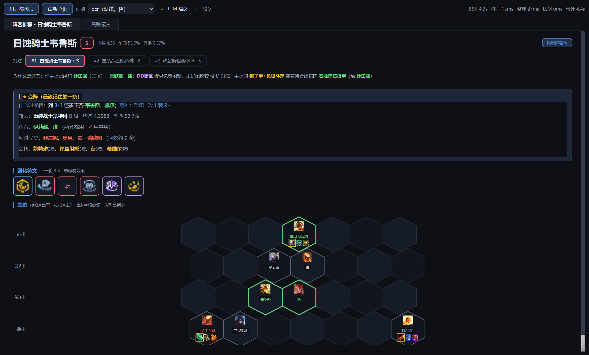
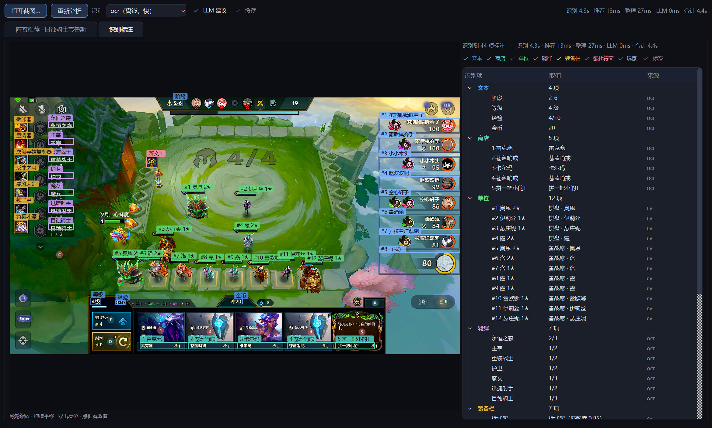

# jcc_s18 — 金铲铲之战截图分析工具箱

从一张对局截图里读出**阶段 / 等级 / 经验 / 金币 / 商店 / 玩家排名与血量 / 棋盘单位（星级+位置+装备）/ 羁绊 / 装备栏 / 强化符文**，再用规则推荐阵容、变阵、符文、装备与站位。默认走本地 OCR/CV；只有文本校验失败回落或显式 `--names` 时才调用 VLM。

带一个 PyQt6 图形助手：左边看「为什么打这套、怎么变阵、抢哪些符文、站位带谁的装备」，右边看「机器到底读到了什么」。

> 仅支持**金铲铲之战（PC 模拟器）**，不覆盖云顶之弈 PC 客户端。默认坐标按 16:9（≈1.75）标定。
>
> 文档已按模块拆分：本页只保留简介、快速开始和导航，细节见 [`docs/`](docs/README.md)。

## 界面

**阵容推荐** —— 打法切换、为什么是这套、变阵（含留谁卖谁）、符文图标、站位（主C/主坦/副C + 三件推荐装备，金边=核心装）



**识别标注** —— 原图叠加 44 项识别框，右侧按分组列出取值与来源（ocr / cv / vlm / label），点表格或点框互相跳转



---

## 功能

| 能力 | 产出 | 实现 |
|---|---|---|
| 文本字段 | 阶段、等级、经验、金币、商店 5 卡 | 本地 OCR 紧框 + 校验，失败回落 VLM |
| 棋盘单位 | 数量、星级、位置、3 格装备、棋盘/备战席 | 纯 CV：绿血条 + 颜色 + 模板匹配 |
| 玩家列表 | 8 人排名、血量、自己 | 橙色头像环定位 + OCR |
| 羁绊 | 名称、数量、档位、激活档 | 左侧面板逐行 OCR |
| 装备栏 | 最左侧散件/道具 | 栅格 + 装备模板匹配 |
| 强化符文 | 图标定位、候选名、可信度 | 深蓝底定位 + 二值形状 IoU |
| 英雄名字（可选） | `单位[].name` | `--labels` 离线标注匹配；`--names` VLM + 缓存 |
| 阵容/行动建议（可选） | Top 3 阵容、缺失单位、买/升/搜/存 | `recommend.py` 规则评分，读取 `s18db`（含符文风格） |
| 图形界面对局助手 | 推荐页（站位/变阵/符文/装备/拿牌 + LLM 教练）、识别标注页 | `advisor/app.py`（PyQt6，串起上面全部能力） |

输出附带 `_来源`（每个字段由谁产出）、`_耗时`、`_告警`。

---

## 快速开始

### 依赖

```bash
python -m pip install numpy scipy Pillow
python -m pip install -i https://mirrors.aliyun.com/pypi/simple/ rapidocr-onnxruntime
```

- 本地 OCR 需要 `rapidocr-onnxruntime`；不装时 `hybrid` 会把文本字段全部回落 VLM（不再是离线流程）。
- 标注器与对局助手另需 `PyQt6`；重新打包 exe 再加 `PyInstaller`。

### 可选：云端 VLM / LLM 的 key

只有 `--backend vlm/hybrid`、`--names` 和助手的「LLM 建议」需要联网，用的是阿里云百炼
（OpenAI 兼容接口）。**仓库不内置任何 key**，自己设环境变量：

```powershell
# Windows（当前会话）
$env:DASHSCOPE_API_KEY = "sk-你的key"
# 永久生效
setx DASHSCOPE_API_KEY "sk-你的key"
```

```bash
# macOS / Linux
export DASHSCOPE_API_KEY="sk-你的key"
```

没设也不会崩：`scan.py --backend ocr` 完全离线；助手的教练文案自动回落成规则文案。

### 运行

```bash
python scan.py 截图.png                        # 默认 hybrid
python scan.py 图1.png 图2.png --json out.json
python scan.py 图1.png --backend ocr           # 全离线，不调 VLM
python scan.py 图1.png --backend vlm           # 文本走云端（棋盘默认仍 CV）
python scan.py 图1.png --budget 3 --save-crops # VLM 截止 3s；存裁剪块
python scan.py 图1.png --labels                # 离线用人工标注认名字
python scan.py 图1.png --names                 # 实验性：VLM + 缓存认名字

# 阵容/行动建议：一条命令完成扫描 + 推荐（只输出摘要）
python recommend.py --image 图1.png --brief

# 需要保留中间结果时
python scan.py 图1.png --labels --json state.json
python recommend.py state.json --json plan.json
```

图形界面对局助手（推荐页 + 识别标注页，整条链路约 4~6s）：

```bash
python advisor/app.py                 # 打开界面，拖图或点「打开截图」
python advisor/app.py 图.png           # 带图启动
python advisor/pipeline.py 图.png      # 只跑流水线，命令行看结果（--no-llm 关 LLM）
```

跳过模块：

```bash
python scan.py 图.png --no-players --no-units --no-traits --no-items --no-augments
```

单模块 / 坐标预览：

```bash
python core/ocr_extract.py 图.png
python core/vlm_board_scan.py 图.png
python tools/make_crop_preview.py 图.png       # 需要先 --save-crops
```

### 输出

字段说明见 [architecture · 输出结构](docs/architecture.md#输出结构)。当前样例：

- [output/sample_result.json](output/sample_result.json)：`--backend hybrid` 完整输出（2026-11-02 重跑）。
- [output/sample_ocr_result.json](output/sample_ocr_result.json)：`--backend ocr` 输出。
- [output/未识别示例.json](output/未识别示例.json)：分割成功但名字认不出的对照。
- [output/分割结果预览.png](output/分割结果预览.png)：5 个裁剪块可视化。
- [output/crops_sample/](output/crops_sample/)：实际送进模型的裁剪原件。
- [output/sample_state.json](output/sample_state.json)：`--labels` 生成的带名字局面，供 `recommend.py` 使用。
- [output/sample_plan.json](output/sample_plan.json)：推荐器完整输出示例。

> 本次样例 hybrid 未触发 VLM 回落，所以 `sample_result.json` 与 `sample_ocr_result.json` 内容相同；保留两份用于字段口径对照。

### 耗时量级

1919×1097、单进程、模型已加载：全流程约 **1.16s**；冷启动首张约 3.7s（OCR 模型 + 符文掩膜）。分项数据见 [architecture · 实测耗时](docs/architecture.md#实测耗时)。

---

## 文档导航

| 文档 | 简要介绍 |
|---|---|
| [docs/README.md](docs/README.md) | 文档总索引：按目标、模块、主题查找 |
| [docs/architecture.md](docs/architecture.md) | 端到端流水线、模块边界、输出结构、耗时 |
| [docs/backends.md](docs/backends.md) | OCR / VLM / hybrid、校验规则、VLM 配置与实测 |
| [docs/calibration.md](docs/calibration.md) | `REGIONS` / `TIGHT` 两套坐标、16:9 与 wide、校准步骤 |
| [docs/data.md](docs/data.md) | `data/` 资产清单、运行期依赖、图标与缓存、清理记录 |
| [docs/s18db.md](docs/s18db.md) | S18 静态库：阵容/装备/符文/仙灵、字段、缺口、重建 |
| [docs/development.md](docs/development.md) | 环境、命令、代码约定、验证方式、硬编码路径 |
| [docs/troubleshooting.md](docs/troubleshooting.md) | 常见失败现象、原因与处理 |
| [docs/modules/recommend.md](docs/modules/recommend.md) | 规则推荐器：输入/输出、评分、行动规则、限制 |
| [advisor/README.md](advisor/README.md) | 对局助手：两个标签页、耗时预算、LLM 防幻觉、缓存 |
| [AGENTS.md](AGENTS.md) | 给 AI agent 的速查与高危操作提醒 |

### 模块文档

| 模块 | 文档 | 职责 |
|---|---|---|
| `core/board_units.py` | [board-units](docs/modules/board-units.md) | 血条 → 星级 / 位置 / 装备 / 备战席 |
| `core/player_hp.py` | [player-hp](docs/modules/player-hp.md) | 右侧玩家排名、血量、自己 |
| `core/traits.py` | [traits](docs/modules/traits.md) | 左侧羁绊面板 |
| `core/item_bench.py` | [item-bench](docs/modules/item-bench.md) | 最左侧装备栏 |
| `core/augments.py` | [augments](docs/modules/augments.md) | 强化符文定位与形状匹配 |
| `core/hero_names.py` | [hero-names](docs/modules/hero-names.md) | `--names`：VLM 命名 + 缓存 |
| `core/hero_match.py` | [hero-names · --labels](docs/modules/hero-names.md#离线匹配--labels) | 人工标注最近邻 |
| `core/ocr_extract.py` | [backends · OCR](docs/backends.md#ocr-路径) | 文本字段紧框 OCR |
| `core/vlm_board_scan.py` | [backends · VLM](docs/backends.md#vlm-路径) | VLM 调用、`REGIONS` 坐标 |
| `recommend.py` | [recommend](docs/modules/recommend.md) | 规则推荐器：Top 3 阵容 + 行动 |
| `advisor/` | [advisor](advisor/README.md) | PyQt6 对局助手：推荐页 + 识别标注页 |
| `labeler/` | [labeler](docs/modules/labeler.md) | PyQt6 人工标注工具 |

---

## 目录结构

```
jcc_s18/
├── scan.py                 截图 → 局面 JSON
├── recommend.py            局面 JSON → 阵容/行动建议
├── advisor/                图形界面对局助手（PyQt6 + LLM）
├── README.md               本页：简介 / 快速开始 / 导航
├── AGENTS.md               agent 速查
├── config/
│   ├── strategy_rules.json 推荐器节奏参数
│   └── equip_core.json     人工钉死的核心装
├── docs/                   拆分后的文档
│   ├── README.md           文档索引
│   ├── images/             README 用的界面截图
│   ├── architecture.md     架构与流水线
│   ├── backends.md         OCR / VLM / hybrid
│   ├── calibration.md      坐标与校准
│   ├── data.md             数据资产
│   ├── s18db.md            S18 静态库
│   ├── development.md      开发与验证
│   ├── troubleshooting.md  排错
│   └── modules/            各识别模块文档
├── core/                   可 import 的识别模块
├── tools/                  辅助脚本（预览 / 抓取 / 重建）
├── data/                   图标、英雄数据、标注、s18db
│   ├── HeroData.json
│   ├── equipment_s18/      139 装备图标
│   ├── augmenticons_s18/   256 符文图标
│   ├── augmenticons_ingame/游戏内模板（同名覆盖）
│   ├── heroicons_s18/      65 英雄头像（标注器）
│   ├── hero_labels/        人工标注（勿删）
│   └── s18db/              S18 静态知识库
├── labeler/                标注工具（exe + 源码）
└── output/                 样例与运行产物
```

---

## 当前限制

- **固定框硬编码**：换分辨率/宽高比、UI 改版、改语言、UI 缩放都要重标 `REGIONS` / `TIGHT`。
- **宽屏只适配两处**：`player_hp`、`traits` 有 `wide`；`item_bench`、`board_units`、OCR 紧框、VLM `REGIONS` 只有 16:9。
- **别在战斗阶段截图**：伤害数字、技能光效会干扰文字/血条识别。
- **3D 棋子名字不可靠**：`--names` 是实验性；`--labels` 同源可靠、跨地图目前不行。
- **推荐依赖单位名字**：没有名字时 `recommend.py` 只给经济建议；且目前没有对手棋盘，无法做克制/对位。
- **OCR 依赖精确框**：金币框多带 2px 图标就会读错，靠双框投票和 VLM 回落兜底。
- **VLM / LLM 需要自己的 key**：仓库不内置任何密钥，未设置 `DASHSCOPE_API_KEY` 时
  `--backend ocr` 与助手照常可用（教练文案回落规则版），只是不联网。

细节与排错见 [troubleshooting](docs/troubleshooting.md)。

---

## 数据来源

- 英雄图标 / S18 英雄数据：[XJYdemons/JinChanChanTool](https://github.com/XJYdemons/JinChanChanTool) 的 `Resources/HeroDatas/S18/`。
- 静态库：`jcc.datatft.com`（阵容、资料库、评级、仙灵规则、概率表）+ `dataj.cc/hex`（符文统计）。

版本、字段、缺口见 [docs/s18db.md](docs/s18db.md) 与 [data/s18db/INDEX.md](data/s18db/INDEX.md)。

---

## 维护

- 本项目没有测试框架和 CI；改动后用样例截图跑 `scan.py` 人工核对，见 [development](docs/development.md#验证方式)。
- 当前目录不是 git 仓库，删除/重构前请自行备份。
- 2026-11-02 做过一次深度清理：`data/s18db/raw/`、`data/s18db/images/`、`output/` 未引用调试产物已移到临时备份。清单见 [docs/data.md](docs/data.md#本次清理2026-11-02)。
